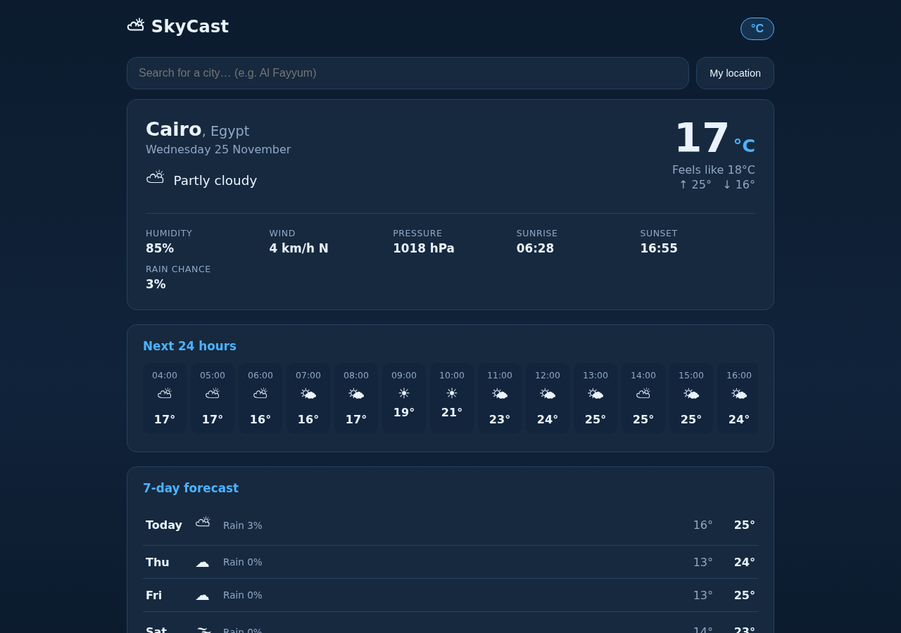
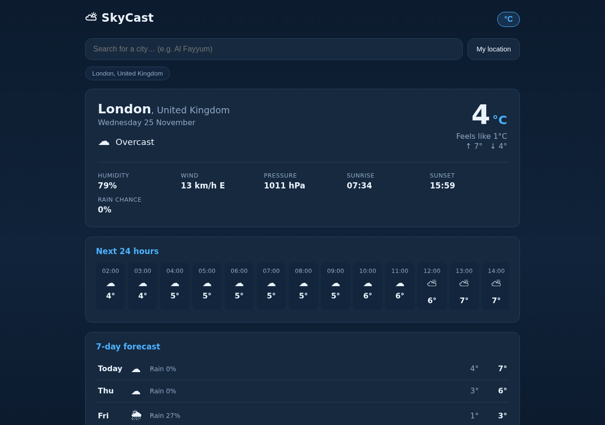
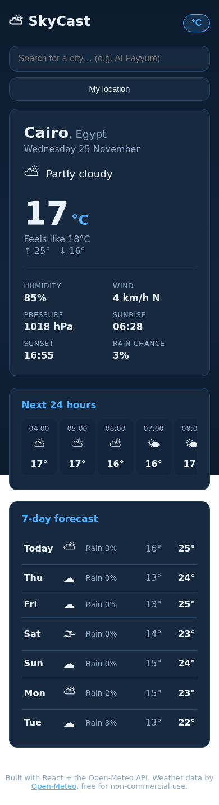

# SkyCast - Weather Forecast App

A weather app built with React. Search any city in the world, use your current
location, and get current conditions, an hour-by-hour forecast for the next
24 hours and a 7-day outlook. Data comes from the free
[Open-Meteo](https://open-meteo.com) API, so no API key or signup is needed.

**Live demo:** https://malakmo7amed309.github.io/weather-app/

## Features

- Current conditions: temperature, feels-like, high/low, humidity, wind speed
  and direction, pressure, sunrise and sunset
- Hourly forecast for the next 24 hours, aligned to the city's own timezone
- 7-day forecast with high/low temperatures and rain probability
- City search with autocomplete (debounced, via the Open-Meteo geocoding API)
- "My location" button using the browser's Geolocation API
- Recent searches saved as quick chips in `localStorage`
- °C / °F toggle, also remembered between visits
- Loading, error-with-retry and empty states
- Fully responsive, dark sky theme

## Tech stack

- React 19 + Vite
- Axios for API requests
- Open-Meteo forecast + geocoding APIs (free, no key required)
- Browser Geolocation API and `localStorage`
- Plain modern CSS (custom properties, grid, flexbox)

## Screenshots

| Current + hourly + daily | Search |
| --- | --- |
|  |  |

| Mobile |
| --- |
|  |

## Run locally

```bash
npm install
npm run dev
```

Then open http://localhost:5173/weather-app/.

To create a production build:

```bash
npm run build
npm run preview
```

## How the code works

New to this codebase? Read [docs/how-it-works.md](docs/how-it-works.md) for a
plain-language walkthrough of the data flow, the debounced search and the
main React concepts used here.
